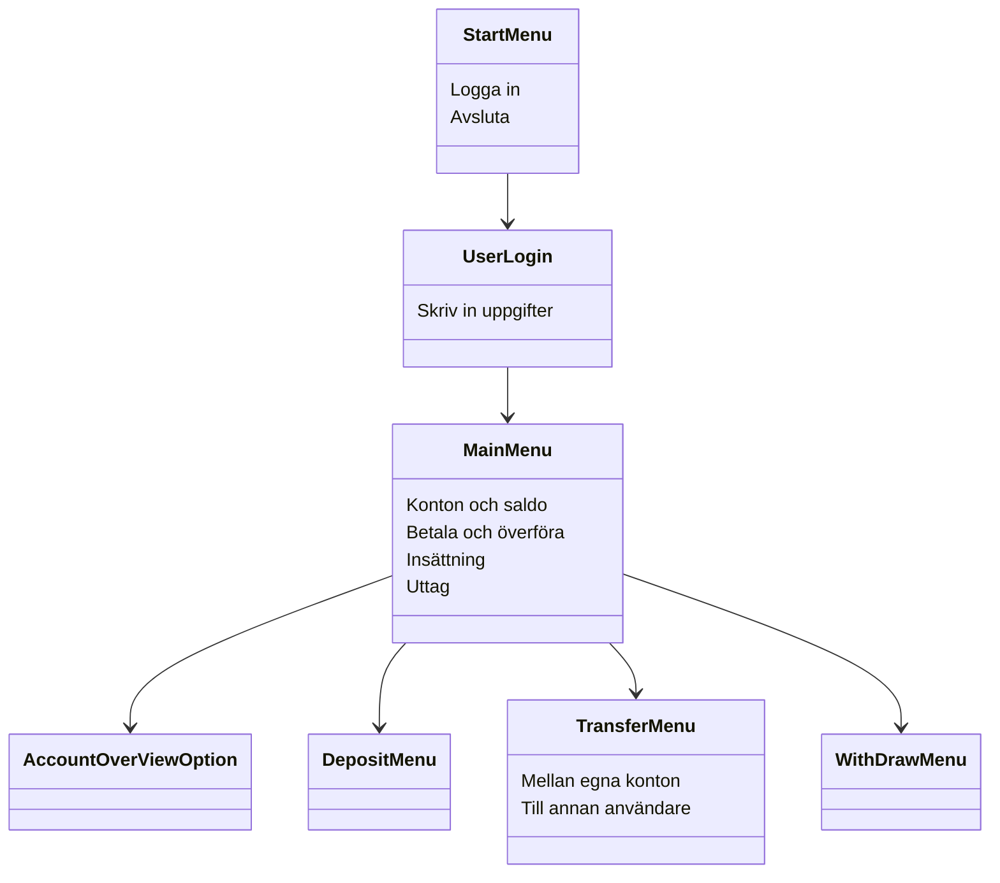

Läs [CONTRIBUTING.md](CONTRIBUTING.md) innan du börjar jobba i projektet.

# 🏧 Bankomaten

Detta är en konsolapplikation och ett skolprojekt som simulerar en bankomat i en enkel form. Bankomaten simulerar hantering av pengar så som en bankomat gör. Applikation har 5 fasta användare och auto-genererar dynamiskt antal konto och saldo när programmet startar.

## 🚀Funktioner
* **Inloggning**
  * Användaren loggar in med användarnamn och pinkod.
  * Blir utelåst om fel pinkod anges 3 gånger.
  * Pinkoden döljs och ersätts av stjärnor vid inmatning.
* **Se konton och saldon**
  * Se alla konton och saldo.
* **Överföring mellan konton**
  * För över pengar mellan egna konton.
  * För över pengar mellan olika användare.
* **Överföring till eget konto**
  * Sätt in pengar till ett eget konto.

## 🏗️ Funktionsöversikt

## 📊 Klassdiagram
 

## 🤔Reflektion/resonemang
Samarbetet i projektet började lite osäkert, då våra olika erfarenheter av GitHub och projektarbete överlag var de största motgångarna. Detta löste vi genom tätare gruppmöten där vi gick igenom vad vi arbetade med och vad som behövde göras framöver. 
Det var väldigt produktiva möten där vi satt i flera timmar och fattade gemensamma beslut. 
Arbetet delades upp med hjälp av issues på GitHub, där varje person själv fick välja vad de ville arbeta med. Nya issues skapades löpande vid behov, oftast efter gemensamma diskussioner under våra gruppmöten.
GitHub användes sedan igen för att granska och godkänna allas kod innan den slogs ihop med huvudprojektet. 
Detta skapade en trygg miljö där ingen var rädd för att ställa frågor och lära sig något nytt.

Det finns alltid saker man hade velat ändra om man fick börja om från början. 
I vårt fall hade ett mer konkret planeringsmöte innan projektstarten i kombination med fler avstämningsmöten under projektets gång, löst nästintill alla våra bekymmer. Den goda arbetsmiljö och det samarbete som trädde fram i slutskedet gav väldigt mycket för både den individuella utvecklingen och för slutprodukten, och det hade underlättat om detta funnits på plats redan från start.

## Val av datastrukturer
I projektet har vi använt flera olika datastrukturer beroende på hur vi behöver lagra och hämta data:

* **Interface:** Vi använder ett interface för att skapa en struktur över hur valen i huvudmenyn ska bete sig, vilket gör att vi slipper skapa nya objekt för varje enskilt menyval.
* **Array:** Vi använder en array där vi vet att storleken inte kommer att ändras under körning, till exempel för våra menyval i huvudmenyn.
* **List:** Vi använder `List` där vi inte vet storleken på listan på förhand. Detta används exempelvis för våra konton eftersom vi genererar slumpmässiga konton för våra testanvändare när programmet körs.
* **Dictionary:** Vi använder en `Dictionary` för våra användare, där en användares namn sparas som en sträng i `Key` och användaren som objekt sparas som `Value`. Detta låter oss snabbt hitta en användare med en sträng för validering vid inloggning och överföringar.
* **Stack:** Vi använder en `Stack` för vår transaktionshistorik så datan sparas kronologiskt med det som hände senast överst, och Last In First Out gör det lättare att skriva ut historiken för användaren i rätt ordning.
Valet av `Stack` passar bättre för vår applikation såsom den är uppbygg, men en `Queue` som sparar datan linjärt med First In First Out gör det enklare att ta bort den äldsta transaktionen för att spara minne om transaktionshistoriken skulle bli för lång.

## Val av datatyper
* **Integer (`int`):** För våra menyval använder vi oss av heltal för att validera och säkerställa att användaren har valt ett giltigt alternativ.
* **Decimal (`decimal`):** Vi använder `decimal` för alla belopp och saldon för att inte förlora någon precision på grund av avrundningsfel, då det är viktigt att varje öre kommer med vid transaktioner i bankomaten.
* **Enum (`enum`):** Vi använder en `enum` för våra transaktionstyper eftersom hur datan används kan skilja sig åt i olika klasser. Vi använder sedan en `switch`-sats först när vi skriver ut transaktionshistoriken för att omvandla transaktionstypen till en sträng.

## Framtida förbättringar
Med mer tid för projektet hade vi gärna lagt till följande funktionalitet:
- [ ] Möjligheten att registrera nya användare i programmet.
- [ ] En funktion som låter en inloggad användare öppna nya konton.
- [ ] Möjligtheten för användaren att gå tillbaka till föregående steg efter valet att överföra, göra insättning eller göra ett uttag. 
- [ ] En utökad vy för att se en komplett transaktionshistorik för användaren eller för ett specifikt konto.
- [ ] En databaslösning för användare, konton, saldon och historik som sparar informationen permanent mellan körningar.

## 👷Arbetsfördelning (huvudansvar)
### 🧑Marcus Jungersten
  * Skapat inloggning och insättning till eget konto.
  * Påbörja/bygga upp strukturen av README.md.
  * Skapa presentation.
### 🧑Ben Johansson
 * Skapade UserManagement och WithdrawMenu.
### 🧑Nils Olmås
 * Skapade första versionen av User och Acccount.
 * Skapade interface IMenuOptions och AccountOverviewOption.
 * Skapade StarMenu och MainMenu.
 * Formaterade konsolltext och menytitlar.
### 🧑Volodymyr Petrunin
 * Skapade repot på GitHub, CONTRIBUTING.md och de första issues.
 * Skapade ConsoleInputValidation för inmatning och validering.
 * Skapade överföring mellan egna konton och till andra användare (TransferMenu och metoderna i BankService).
 * Skapade UML-klassdiagrammet.

#### _Notering. Flera utav hjälpklasserna har vi alla varit med och bidragit till._
