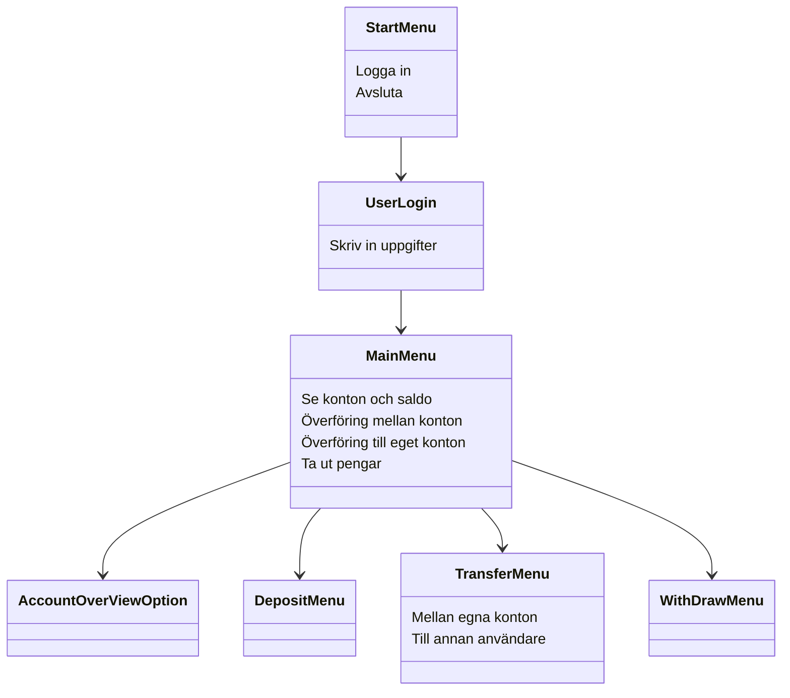

Läs [CONTRIBUTING.md](CONTRIBUTING.md) innan du börjar jobba i projektet.

# 🏧 Bankomaten

Detta är en konsolapplikation och ett skolprojekt som simulerar en bankomat i en enkel form. Bankomaten simulerar hantering av pengar så som en bankomat gör. Applikation har 5 fasta användare och auto-genererar dynamiskt antal konto och saldo när programmet startar.

## 🚀Funktioner
* **Inloggning**
  * Användaren loggar in med användarnamn och pinkod.
  * Blir utelåst om fel pinkod anges 3 gånger.
  * Pinkoden döljs och ersätts av stjärnor vid inmatning.
* **Se konton och saldon**
  * Se alla konton och saldo.
* **Överföring mellan konton**
  * För över pengar mellan egna konton.
  * För över pengar mellan olika användare.
* **Överföring till eget konto**
  * Sätt in pengar till ett eget konto.

## 🏗️ Funktionsöversikt

## 📊 Klassdiagram

## 🤔Reflektion/resonemang

## 👷Arbetsfördelning (huvudansvar)
### 🧑Marcus Jungersten
  Skapat inloggning och insättning till eget konto.
### 🧑Ben Johansson
### 🧑Nils Olmås
### 🧑Volodymyr Petrunin

#### _Notering. Flera utav hjälpklasserna har vi alla varit med och bidragit till._
