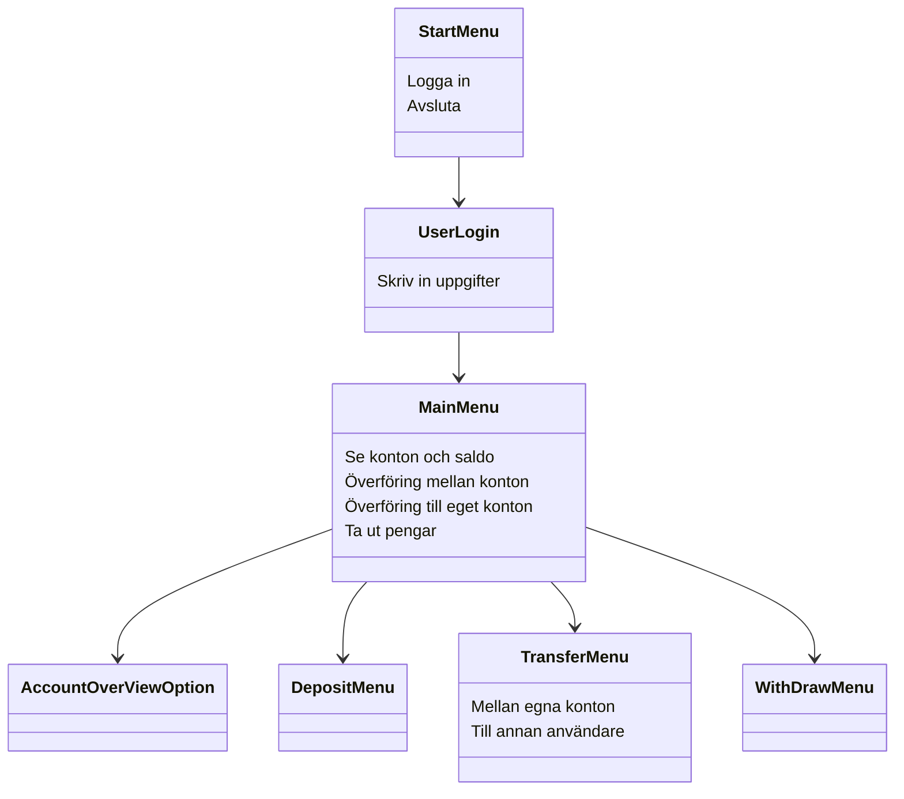
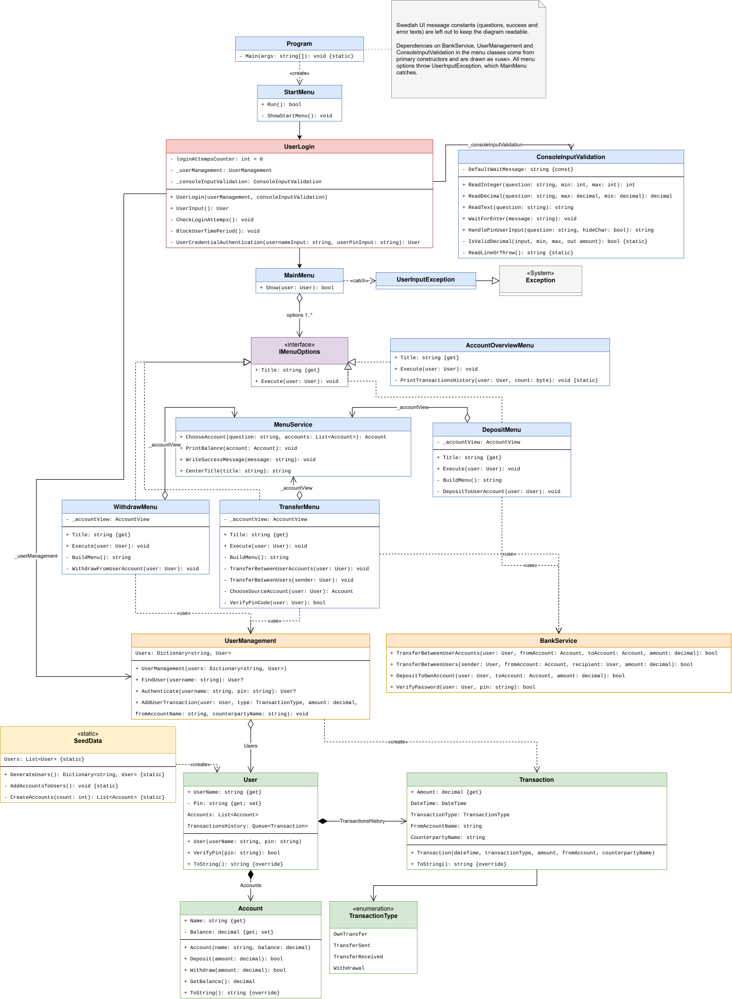

Läs [CONTRIBUTING.md](CONTRIBUTING.md) innan du börjar jobba i projektet.

# 🏧 Bankomaten

Detta är en konsolapplikation och ett skolprojekt som simulerar en bankomat i en enkel form. Bankomaten simulerar hantering av pengar så som en bankomat gör. Applikation har 5 fasta användare och auto-genererar dynamiskt antal konto och saldo när programmet startar.

## 🚀Funktioner
* **Inloggning**
  * Användaren loggar in med användarnamn och pinkod.
  * Blir utelåst om fel pinkod anges 3 gånger.
  * Pinkoden döljs och ersätts av stjärnor vid inmatning.
* **Se konton och saldon**
  * Se alla konton och saldo.
* **Överföring mellan konton**
  * För över pengar mellan egna konton.
  * För över pengar mellan olika användare.
* **Överföring till eget konto**
  * Sätt in pengar till ett eget konto.

## 🏗️ Funktionsöversikt

## 📊 Klassdiagram
 

## 🤔Reflektion/resonemang
 * I dagsläget går det inte att ångra sig och gå tillbaka till föregående meny när användaren ska överföra, göra insättning eller göra ett uttag. Detta skulle enkelt åtgärdas med hjälp av ett GUI med exempelvis en bakåtknapp.
 * Man skulle kunna ha komplett historik (jämfört med nuvarande som bara visa 3 senaste transaktioner), men vi såg detta var onödigt då vi inte sparar all historik i en fil.
## 👷Arbetsfördelning (huvudansvar)
### 🧑Marcus Jungersten
  * Skapat inloggning och insättning till eget konto.
  * Påbörja/bygga upp strukturen av README.md.
  * Skapa presentation.
### 🧑Ben Johansson
 * Skapade UserManagement och WithdrawMenu.
### 🧑Nils Olmås

### 🧑Volodymyr Petrunin

#### _Notering. Flera utav hjälpklasserna har vi alla varit med och bidragit till._
